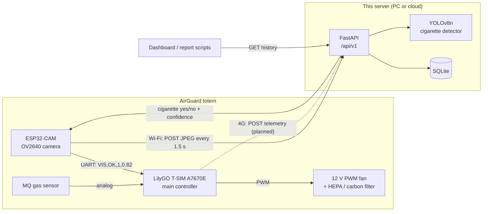
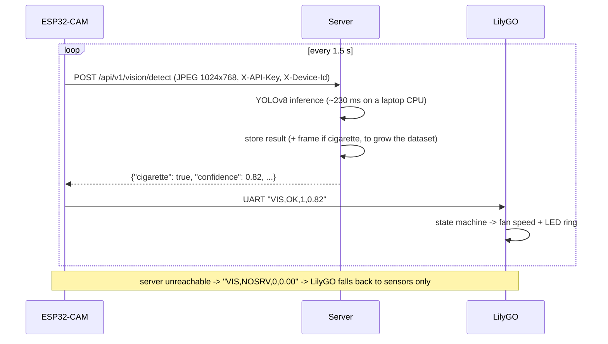
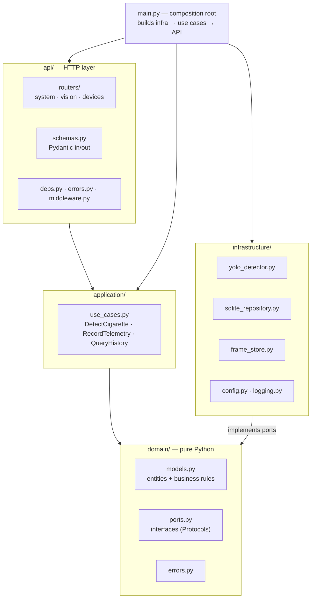
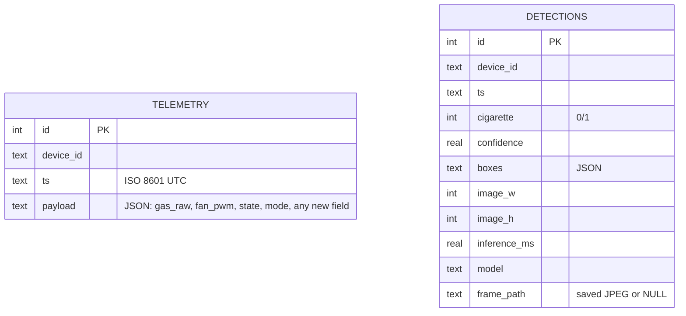

# AirGuard — Backend server

Backend of **AirGuard**, a smart air-filtering totem shaped like a cigarette (IoT module, Pr Chaouche — Université Constantine 2).
The totem measures air quality, **detects lit cigarettes with a camera**, and drives a HEPA + activated-carbon filter accordingly.
This server runs the cigarette detector (YOLOv8) and stores everything the totems send.

- [1. The AirGuard project](#1-the-airguard-project)
- [2. Where this server fits](#2-where-this-server-fits)
- [3. Getting started (teammate setup)](#3-getting-started-teammate-setup)
- [4. API reference](#4-api-reference)
- [5. Code architecture](#5-code-architecture)
- [6. Configuration](#6-configuration)
- [7. The detection model](#7-the-detection-model)
- [8. Device side (ESP32-CAM / LilyGO)](#8-device-side-esp32-cam--lilygo)
- [9. Development workflow](#9-development-workflow)
- [10. Troubleshooting](#10-troubleshooting)
- [11. Roadmap](#11-roadmap)

---

## 1. The AirGuard project

AirGuard combines three functions in a cylindrical totem (Ø130 × 360 mm):

| Function | Hardware | Role |
|---|---|---|
| **Monitoring** | MQ gas sensor (Flying Fish module) | measures ambient air quality |
| **Detection** | ESP32-CAM (OV2640) + **this server** | detects a lit cigarette (computer vision) |
| **Action** | 12 V PWM fan + HEPA / activated-carbon filter | filters the air according to sensors + vision |

The controller is a **LilyGO T-SIM A7670E** (ESP32 + 4G LTE Cat-1 modem).
The project evaluates two control modes: **sensors only** vs **sensors + vision**.

Totem states:

| State | Condition | Fan | LED ring |
|---|---|---|---|
| `veille` (idle) | air OK, no cigarette | low / off | 🟢 green |
| `filtration` | gas threshold exceeded | medium | 🟠 orange |
| `alerte` (alert) | cigarette detected or air degraded | full speed | 🔴 red |

## 2. Where this server fits



One detection cycle:



## 3. Getting started (teammate setup)

### Prerequisites

| Tool | Version | Check |
|---|---|---|
| Python | 3.11 or newer | `python3 --version` |
| Git | any recent | `git --version` |
| Disk | ~1.5 GB (PyTorch CPU + Ultralytics) | |

No GPU needed: inference runs on the CPU.

### Step by step

**1. Clone the repository**

```bash
git clone <REPO_URL> airguard-server
cd airguard-server
```

**2. Create a virtual environment**

```bash
python3 -m venv .venv
source .venv/bin/activate          # Windows: .venv\Scripts\activate
```

**3. Install PyTorch (CPU build) then the dependencies**

```bash
pip install torch torchvision --index-url https://download.pytorch.org/whl/cpu
pip install -r requirements.txt
```

> The CPU build of PyTorch is ~200 MB; the default one pulls ~2 GB of CUDA libraries you do not need.

**4. Create your local configuration**

```bash
cp .env.example .env
python -c "import secrets; print(secrets.token_urlsafe(24))"   # generates an API key
```

Open `.env` and paste the generated value into `DEVICE_API_KEY=`.
**Never commit `.env`** (it is git-ignored). If you run the server for the real totem, use the **same key** as the one flashed in the ESP32-CAM (`firmware/airguard_cam/secrets.h`) — ask the team for it.

**5. Run the tests**

```bash
python -m pytest
```

Expected: `13 passed`. The first run loads the model (a few seconds).

**6. Start the server**

```bash
uvicorn app.main:app --host 0.0.0.0 --port 8000
```

- `--host 0.0.0.0` makes it reachable from the ESP32-CAM on the same network.
- Interactive docs: **http://localhost:8000/docs** (try every endpoint from the browser).
- Health check: `curl http://localhost:8000/health`

**7. Try a detection from the command line**

```bash
curl -X POST http://localhost:8000/api/v1/vision/detect \
  -H "X-API-Key: <your key>" -H "X-Device-Id: totem1" \
  -H "Content-Type: image/jpeg" --data-binary @tests/fixtures/cigarette.jpg
```

**8. Connect the real camera (optional)**

1. PC and ESP32-CAM on the **same 2.4 GHz Wi-Fi** (the ESP32 cannot use 5 GHz).
2. Find your PC's IP (`ip -4 addr` on Linux, `ipconfig` on Windows) and set it in the camera's `SERVER_URL`.
3. Open port 8000 in your firewall (see [Troubleshooting](#10-troubleshooting)).
4. Watch the server log: one `vision.detect` line every 1.5 s.

## 4. API reference

All device endpoints require the header `X-API-Key: <DEVICE_API_KEY>`. Base path: `/api/v1`.

| Method | Path | Auth | Used by | Description |
|---|---|---|---|---|
| `GET` | `/health` | — | monitoring | `{"status": "ok", "model": "..."}` |
| `POST` | `/api/v1/vision/detect` | key | ESP32-CAM | body = raw JPEG; returns the detection |
| `POST` | `/api/v1/devices/{id}/telemetry` | key | LilyGO | stores one sensor sample |
| `GET` | `/api/v1/devices/{id}/telemetry` | — | dashboard / report | history, newest first (`?limit=&since=`) |
| `GET` | `/api/v1/devices/{id}/detections` | — | dashboard / report | vision history (`?limit=&since=`) |
| `GET` | `/api/v1/devices` | — | dashboard | devices seen, last activity |

### `POST /api/v1/vision/detect`

Headers: `X-API-Key`, `X-Device-Id` (default `esp32cam`), `Content-Type: image/jpeg`. Body: the JPEG bytes (max 2 MB).

```json
{
  "cigarette": true,
  "confidence": 0.282,
  "boxes": [{"x1": 0.2593, "y1": 0.3239, "x2": 0.4718, "y2": 0.4116, "confidence": 0.282}],
  "image_size": [640, 640],
  "inference_ms": 225.9,
  "model": "airguard_yolov8n_ep25.pt"
}
```

- `boxes` use **normalised coordinates (0–1)**, independent of the image size.
- `cigarette` is `true` when one box reaches `DETECT_THRESHOLD` (default 0.25). Boxes down to 0.10 are still returned and logged, to study near-misses.
- Errors: `401` wrong key · `413` image too large · `422` not an image / empty body.

### `POST /api/v1/devices/{id}/telemetry`

```json
{
  "gas_raw": 1830,
  "fan_pwm": 60,
  "fan_rpm": 2400,
  "cigarette": false,
  "cigarette_confidence": 0.0,
  "state": "filtration",
  "mode": "sensors_vision",
  "ts": "2026-11-22T10:00:00Z"
}
```

All fields are optional and validated (`gas_raw` 0–4095, `fan_pwm` 0–100 %, `state` ∈ `veille|filtration|alerte`, `mode` ∈ `sensors|sensors_vision`).
**Unknown fields are accepted and stored** — a new sensor needs no server change. Without `ts`, the server time is used. Returns `201 {"id": 1, "ts": "..."}`.

## 5. Code architecture

The code follows **clean architecture**: the business core does not know FastAPI, SQLite or YOLO. Dependencies point **inwards only**.



| Layer | Folder | Contains | May import |
|---|---|---|---|
| Domain | `app/domain/` | entities (`DetectionResult`…), the threshold rule, **ports** (interfaces), errors | nothing |
| Application | `app/application/` | use cases: what the system does | domain |
| Infrastructure | `app/infrastructure/` | YOLO, SQLite, filesystem, settings, logging — implementations of the ports | domain |
| API | `app/api/` | routes, request/response schemas, auth, error → HTTP mapping | application, domain |
| Composition | `app/main.py` | wires everything at startup (`Container`) | all |

**Why it matters for us**

- **Swap the detector** (e.g. an Edge Impulse FOMO model): write a class implementing `DetectorEngine`, change one line in `main.py`.
- **Swap the database** (e.g. PostgreSQL): write a repository class; use cases and API unchanged.
- **Test the logic without the model**: `tests/test_use_cases.py` uses in-memory fakes and runs in milliseconds.

### Project structure

```
.
├── app/
│   ├── main.py                     composition root + FastAPI app
│   ├── domain/
│   │   ├── models.py               Box, RawDetection, DetectionResult (threshold rule), records
│   │   ├── ports.py                DetectorEngine, *Repository, FrameStore, Clock
│   │   └── errors.py               InvalidImage, ImageTooLarge
│   ├── application/
│   │   └── use_cases.py            DetectCigarette, RecordTelemetry, QueryHistory
│   ├── infrastructure/
│   │   ├── config.py               Settings (env vars / .env)
│   │   ├── yolo_detector.py        YOLOv8 implementation of DetectorEngine
│   │   ├── sqlite_repository.py    SQLite implementation of the repositories
│   │   ├── frame_store.py          saves camera frames for future training
│   │   └── logging.py              structlog (console in dev, JSON in production)
│   └── api/
│       ├── routers/                system.py · vision.py · devices.py
│       ├── schemas.py              Pydantic contracts + domain → JSON mapping
│       ├── deps.py                 use-case injection + API-key check
│       ├── errors.py               domain errors → HTTP status codes
│       └── middleware.py           request_id on every log line
├── models/airguard_yolov8n_ep25.pt trained weights (6.6 MB)
├── tests/
│   ├── test_use_cases.py           unit tests with fakes
│   ├── test_api.py                 end-to-end HTTP tests (real model, temp DB)
│   └── fixtures/cigarette.jpg
├── data/                           (created at runtime, git-ignored) airguard.db, frames/
├── .env.example                    configuration template
├── requirements.txt
└── pytest.ini
```

### Data model (SQLite)



Telemetry keeps its fields in a JSON column, so adding a sensor needs no migration.

## 6. Configuration

All settings come from environment variables or `.env` (see `.env.example`).

| Variable | Default | Description |
|---|---|---|
| `DEVICE_API_KEY` | **required** (16+ chars) | shared secret the devices send in `X-API-Key` |
| `ENVIRONMENT` | `dev` | `production` disables `/docs` and logs JSON |
| `MODEL_PATH` | `models/airguard_yolov8n_ep25.pt` | YOLO weights |
| `MODEL_IMGSZ` | `960` | inference resolution |
| `DETECT_THRESHOLD` | `0.25` | confidence above which `cigarette = true` |
| `MAX_IMAGE_BYTES` | `2000000` | upload limit |
| `SAVE_FRAMES` | `positive` | keep frames: `none` · `positive` · `all` |
| `FRAMES_DIR` | `data/frames` | where frames are saved |
| `DB_PATH` | `data/airguard.db` | SQLite file |

## 7. The detection model

- **Architecture:** YOLOv8n (3.1 M parameters), one class: `cigarette`.
- **Training data:** ~13,800 images from 5 public datasets, all **CC BY 4.0**:
  CigDet (Mendeley Data, doi:10.17632/6hyrr8typ7.1), and Roboflow Universe projects
  `smokingcigarettecctv/smoking-detection-dsg67` v3, `dpp/cigarette-detection-bow3d` v11,
  `sinar/people-smoking-detection` v3, `mike-ovbzu/cigarette_detection-g9e6e` v6.
  The test fixture `tests/fixtures/cigarette.jpg` comes from `dpp/cigarette-detection-bow3d`.
- **Current weights:** `airguard_yolov8n_ep25.pt` — epoch 25/60 at 960 px, **mAP50 = 0.39**, precision 0.42, recall 0.47 on the validation set. Training is still in progress; detections are correct but with low confidence (0.25–0.30).
- **Updating the model:** drop the new `best.pt` in `models/`, set `MODEL_PATH` in `.env`, restart. No code change.
- Training scripts and the Colab notebook live in the main project (`tools/vision/`).

> Why server-side inference? A cigarette at 2 m is ~3 px long in a 96×96 on-device image but ~50 px in the camera's full-resolution frame. An on-device Edge Impulse FOMO model is planned as an offline fallback.

## 8. Device side (ESP32-CAM / LilyGO)

Firmware is in the main project (`firmware/airguard_cam/`). What the server team needs to know:

- The camera sends one **1024×768 JPEG every 1.5 s** with headers `X-API-Key` and `X-Device-Id: totem1`.
- It forwards each answer to the LilyGO over UART (115200 baud, ESP32-CAM GPIO 13 → LilyGO GPIO 22):

| Line | Meaning |
|---|---|
| `VIS,OK,1,0.82` | cigarette detected, confidence 0.82 |
| `VIS,OK,0,0.00` | no cigarette |
| `VIS,NOSRV,0,0.00` | server unreachable or error → LilyGO switches to sensors-only |
| `VIS,NOWIFI,0,0.00` | camera not connected to Wi-Fi |

So **if the server is down the totem keeps working**, only without vision.

## 9. Development workflow

### Adding an endpoint

1. **Domain** (if needed): a new entity in `models.py`, a new interface in `ports.py`.
2. **Use case**: a class in `application/use_cases.py` taking its ports in `__init__`.
3. **Infrastructure** (if needed): implement the port (e.g. a method in `SqliteRepository`).
4. **API**: a router in `app/api/routers/` + schemas in `schemas.py`.
5. **Wire it** in `main.py` (`Container` + `app.include_router`).
6. **Test**: a unit test with fakes + an API test.

Example: a CSV export for the evaluation report = a `QueryHistory` method + a `GET .../telemetry.csv` route.

### Rules

- Blocking work (YOLO, SQLite) runs in threads (`asyncio.to_thread`) — never block the event loop.
- Validation lives in Pydantic schemas, not in route bodies.
- No `print()`: use `structlog.get_logger()`; each log line carries a `request_id`.
- No secrets in code: everything through `Settings` / `.env`.

### Git

```bash
git checkout -b feat/my-feature
python -m pytest              # must stay green
git commit -m "feat(api): ..."   # conventional commits: feat, fix, refactor, test, docs, chore
git push -u origin feat/my-feature   # then open a pull request
```

## 10. Troubleshooting

| Symptom | Cause / fix |
|---|---|
| `ValidationError: device_api_key` at startup | `.env` missing or key shorter than 16 chars → step 4 |
| camera shows `VIS,NOSRV`, server log silent | firewall blocks port 8000. Fedora/Arch: `sudo firewall-cmd --add-port=8000/tcp` · Ubuntu: `sudo ufw allow 8000/tcp` · Windows: allow Python in Windows Defender Firewall |
| camera shows `VIS,NOWIFI` | camera on another network, or a 5 GHz network → use 2.4 GHz |
| `401 invalid API key` | key in the camera's `secrets.h` ≠ `DEVICE_API_KEY` in `.env` |
| `pip` downloads ~2 GB | PyTorch installed with CUDA → install the CPU build first (step 3) |
| slow detections (> 1 s) | lower `MODEL_IMGSZ` to 640 in `.env` |
| `FileNotFoundError` on the model | wrong `MODEL_PATH` |

## 11. Roadmap

- [x] YOLOv8 cigarette detector served over HTTP
- [x] Telemetry storage and history endpoints
- [x] ESP32-CAM firmware sending frames, UART protocol to the LilyGO
- [ ] Finish training (60 epochs) and replace the model
- [ ] Evaluate on our own ESP32-CAM photos (0.5 / 1 / 2 / 3 m, day / night)
- [ ] LilyGO firmware: telemetry over 4G → needs a public URL (Cloudflare Tunnel or cloud host)
- [ ] CSV export for the *sensors only* vs *sensors + vision* evaluation
- [ ] Dashboard
- [ ] Edge Impulse FOMO model on the ESP32-CAM as an offline fallback
